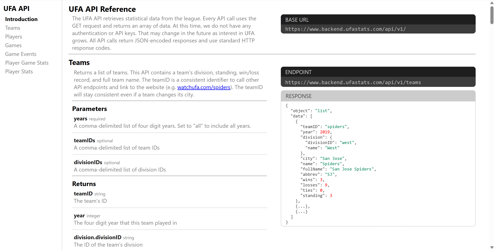

## The Basics

An API (Application Programming Interface) is a set of rules and protocols that allows different software applications to communicate and exchange data with each other. One common way of simplifying this concept is to imagine you are in a restaurant. The end goal is get to be served the food from the kitchen. However, you cannot go directly to the kitchen to acquire food. Because of this, you (the client) must make an order through the waiter (the API) to be able to reach the kitchen (the server). The waiter will taker your order, verify your request, and return your food.

## Accessing Data

Learning how an API works is one thing, but it is important to note that there are many ways to set up an API. This means that while the general process for making a request is the same, the exact methods can vary. That said, there are five elements that make up essentially every API call:

- URL
  - This is the server containing the data that are being targeted. This URL can be found in the API documentation provided by the company/service. To find the data desired, the client uses the base URL along with a specific endpoint that indicates which data the API should retrieve.
- Method
  - Usually this is where something like the GET command is run, which tells the server you want to retrieve records hosted on the server.
- Headers
  - These represent the metadata included in the request and response. They tell the server things like where the request originates and how to handle it.
- Parameters
  - Items appended to the base URL that specify what data is being requested by the client.
- Body (Payload)
  - The data sent from the server to the client, which is most commonly received in a JSON format.

As part of a previous class project, my team and I worked with the API provided by the UFA (Ultimate Frisbee Association). As seen in the image below, the UFA provides documentation about how the data are formatted, the base URL, and the endpoint.

{fig-alt="Screenshot of UFA API reference homepage."}

Documentation like this is crucial to understanding not only how to request information, but how the data requested will be sent from the server.

## How Companies Use APIs
The purpose of an API for most companies goes far beyond allowing anyone to grab their data for a personal project. In reality, APIs have many different use cases. For example, they are critical for the operation of many businesses that leverage online payments. When a customer submits an order for a product, one or more API calls could be made. Examples of these are an API that processes payment, one that confirms the order, and another that updates a database.

It is also important to note the distinction between internal and external APIs. Internal APIs connect different parts of a company’s software, which allows them to communicate with each other. External APIs connect the company to another organization or user’s software. The UFA API mentioned above is a good example of an external API.

## Limitations and Restrictions

The ability to restrict who can access specific information through a specific API is simultaneously a great benefit and drawback. This is a benefit because sensitive information can be kept secure, while public or non-sensitive data can be made available to anyone with access to a machine capable of calling the API. Some of the most important restrictions to be aware of when working with APIs are rate and payload limits. Both are interrelated, but distinct.

- Rate limit: a control that restricts the number of requests a user can make within a given timeframe. 
- Payload limit: a control that determines the maximum amount of data/records that can be sent in response to a request.

Being aware of these restrictions can help a client maintain access to an API along with a sustainable data pipeline.

## Tying It All Together

After having discussed some of the most important parts of APIs and how to work with them, below is an example of how a user could call an API from the website restcountries.com. The steps for doing so can be followed generally for many use cases, and should be helpful to continue working with APIs in a variety of ways.

```{python}

import requests

# 1. Choose the API endpoint
url = "https://restcountries.com/v3.1/name/france"

# 2. Send a request to the API
response = requests.get(url, timeout=10)

# 3. Check whether the request succeeded
if response.status_code == 200:

    # 4. Convert the response into Python data
    countries = response.json()

    # 5. Extract and display the information we need
    country = countries[0]

    print("Country:", country["name"]["common"])
    print("Capital:", country["capital"][0])
    print("Population:", country["population"])

else:
    print("Request failed:", response.status_code)

```
