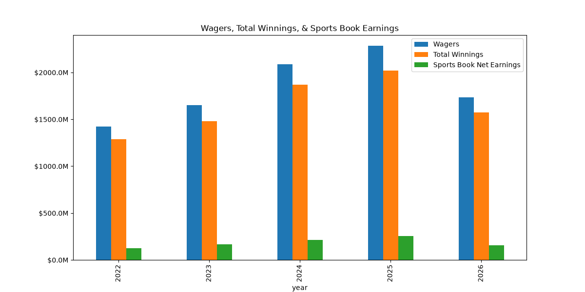

## Introduction
Gambling and sports wagering has existed for ages, but its only recently that it has been legalized in an online fashion in many states and countries. If you are a sports fan like me, chances are you have seen advertisements for companies like FanDuel, DraftKings, MGM Bet and others telling you to take their $100 new player credit so they can acquire your business. And while I am invested in the ethical aspect of gambling, that is not what I am here to discuss.

## Motivating Question
What I do hope to discuss today is this: How has overall sports wagering spend changed since it was legalized? In this case, I looked at data provided by Connecticut Open Data, which dates back to late 2021, when online sports wagering became legal in the state. As someone who does not choose to participate in gambling myself, I realized I have my own biases and looked to find some data that could show me the real story. I originally sought out to see how gambling changed specifically for younger bettors, but had a difficult time finding that information. Additionally, that information might be a little more sensitive than aggregated totals for wagers across licensed operators in Connecticut.

## Ethical Data Collection
In the Connecticut Open Data terms of service, it explains how the organization reserves the right to modify and update data as it sees fit, but there is nothing that would preclude anyone from collecting and presenting the information found therein. After reading this, I determined it would be a viable option to work with this data.

## Acquisition Summary
Obtaining the data from the site is fairly straightforward. Here are the steps I used in order:

1. Navigate to the Connecticut Open Data Site
2. Find the dataset for which you would like to collect data
3. On the page displaying the dataset, click on "Actions"
4. Copy the API endpoint URL to your code
5. Use the `get` function via `import requests` to load the data onto your machine

While gambling metrics were of interest to me, this process can be followed for a large variety of topics on the site to access the information.

## EDA Highlights
As I was exploring the data, I discovered that the measurements for 2021 were often much smaller than future years. After some digging I found that wagers were only recorded in October, November, and December of that year. Because of this, that year was dropped from most of my analysis. Similarly, since I am writing this at the beginning of November 2026, that year is not yet over. However, I felt it would be more interesting to see the aggregations so far and see how they compare. Below are some of my insights.

### Total Wager Amount by Year

::: {.list-table}

- - Year
  - Aggregated Wager Amount

- - 2022
  - $1,421,158,018.00

- - 2023
  - $1,651,986,679.00

- - 2024
  - $2,089,110,946.00

- - 2025
  - $2,284,334,245.00

- - 2026 **(YTD - November 5, 2026)**
  - $1,735,868,089.00

:::

As you can see, online sports wagering as a whole has continued to increase since its legalization, and it is by no small margin. We will see in coming days whether the trend continues through 2026.

### Wagers and Winnings

{fig-alt="Figure showing total patron wagers, winnings, and sports book earnings."}

I found this graph to be insightful, as it shows that even as total wagers increase, the total winnings awarded remain below the amount wagered. While sports betting may seem like there are different odds and more skill involved, the data tells us that the house most certainly always wins.

## Conclusion

If you are interested in exploring the Connecticut Open Data portal, you can check out the site at data.ct.gov. The website is very user friendly and has plenty of things to explore. If the topic of gambling itself interests you, one site I found allows users to easily explore data comes from The University of Indiana and their [2024 Adult Gambling Behaviors in Idiana Survey](https://data.prevention.iu.edu/agbi/). It allows the user to create custom visualizations based on a number of gambling categories.

## Index

To check out the code I wrote to acquire, clean, and analyze this data, [click here.](https://github.com/tannernielsen333/connecticut_gambling_info) 

